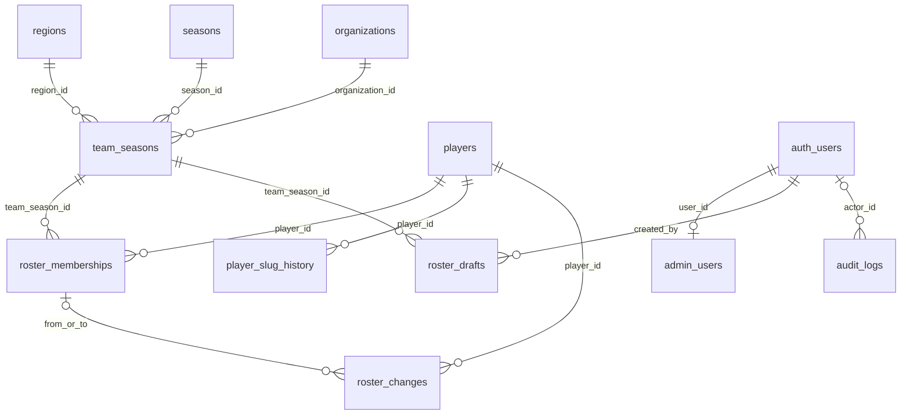

# Schema PostgreSQL — Tarefa 08

As migrations em `supabase/migrations/` criam a estrutura de persistência e as
políticas iniciais. Não inserem regiões, organizações, jogadores ou administradores.
A Tarefa 09 acrescentou leitura pública Supabase e seed manual separado,
documentados em [SUPABASE_SEED.md](SUPABASE_SEED.md). Sem configuração, a aplicação
consulta o snapshot local somente leitura. Nenhum banco remoto foi acessado.
As notas de integração futura abaixo registram o contrato original da Tarefa 08;
o documento da Tarefa 09 descreve conexão e seed. A Tarefa 10 acrescentou a
terceira migration `20261105000100_admin_access_hardening.sql`, com consulta
somente da própria autorização ativa e guardas RLS restritivas de escrita e
leitura privada. Veja [ADMIN_AUTH.md](ADMIN_AUTH.md). Em instalação nova, aplique
as migrations em ordem; as anteriores não foram reescritas. As tarefas 12 e 13
acrescentam gerenciamento de organizações/temporadas e jogadores, descritos em
[ADMIN_ORGANIZATIONS.md](ADMIN_ORGANIZATIONS.md) e [ADMIN_PLAYERS.md](ADMIN_PLAYERS.md).

## Migrations e execução

| Arquivo | Conteúdo |
| --- | --- |
| `20261104000100_vct_schema.sql` | Enums, 11 tabelas, UUIDs, FKs, checks, índices e RLS com acesso negado inicialmente. |
| `20261104000200_vct_security_history.sql` | Triggers de identidade, slugs, timestamps, auditoria, grants e políticas RLS. |
| `20261105000100_admin_access_hardening.sql` | Guardas RLS e autorização administrativa. |
| `20261106000100_organization_management.sql` | Arquivamento de participação e RPCs de organização/temporada. |
| `20261106000200_player_management.sql` | Links de perfil e RPC de jogador com slug único e identidade preservada. |
| `20261106000300_roster_draft_editor.sql` | Snapshot privado e RPCs para salvar/arquivar rascunhos, sem publicação. |
| `20261106000400_roster_publication.sql` | Publicação atômica, função por vínculo, metadados de mudanças e replay sem duplicação. Veja [ADMIN_ROSTER_PUBLICATION.md](ADMIN_ROSTER_PUBLICATION.md). |
| `20261106000500_manual_transfers.sql` | Transferência atômica, pedidos privados para replay, observação pública e RPC de timeline sob RLS. Veja [ADMIN_TRANSFERS.md](ADMIN_TRANSFERS.md). |

Cada arquivo tem sua própria transação. Aplicar todos, na ordem, antes de inserir
dados. São migrations versionadas executadas uma vez; reaplicar o SQL sobre o
mesmo schema deve falhar, em vez de ocultar divergências com `IF NOT EXISTS`.
Correções posteriores devem entrar como novas migrations. Não há script de
reversão destrutiva que apague histórico.

Pré-requisitos do destino: PostgreSQL com `gen_random_uuid()`, `auth.users(id)`,
`auth.uid()` e os papéis Supabase `anon`, `authenticated`, `service_role`.
Executar como proprietário de migrations capaz de criar funções, grants e
políticas. As funções `SECURITY DEFINER` pressupõem proprietário confiável com
acesso às tabelas; não configurar `private` como schema exposto pela API.

Para validar agora, sem credenciais, Docker ou serviço externo:

```powershell
npm ci
npm run test:db
```

O teste cria um PostgreSQL em memória via PGlite, fornece apenas o contrato
mínimo de Auth/roles para teste e executa os arquivos SQL completos. Os cenários
usam IDs aleatórios e dados sintéticos em transações revertidas. O banco é
fechado ao final; não há usuários, senhas ou tokens reais/simulados de produção.

Na integração futura, usar o fluxo de migrations do projeto Supabase. Para uma
instância de desenvolvimento já provisionada com os pré-requisitos acima, os
mesmos arquivos podem ser aplicados por `psql` com uma URL real previamente
definida no ambiente:

```powershell
psql "$env:DATABASE_URL" -v ON_ERROR_STOP=1 -f supabase/migrations/20261104000100_vct_schema.sql
psql "$env:DATABASE_URL" -v ON_ERROR_STOP=1 -f supabase/migrations/20261104000200_vct_security_history.sql
```

Esses comandos não foram executados contra Supabase. Não copiar o bootstrap de
Auth do helper de testes para as migrations ou para um projeto Supabase.
O versionamento do ambiente de destino deve registrar os arquivos aplicados.

## Entidades e relações

| Tabela | Responsabilidade |
| --- | --- |
| `regions` | Identidade UUID, slug e nome da região. |
| `seasons` | Identidade UUID e ano único da temporada. |
| `organizations` | Identidade estável, nome, slug, sigla/logo opcionais. |
| `team_seasons` | Organização + temporada únicos; região e categoria nessa participação. |
| `players` | Identidade estável, nickname, slug e campos opcionais do perfil. |
| `player_slug_history` | Registro reservado de todos os slugs, incluindo o atual. |
| `roster_memberships` | Jogador + participação, status de elenco e período. |
| `roster_drafts` | Proposta privada de elenco, autor e revisão de origem. |
| `roster_changes` | Eventos editoriais publicáveis, ligados a jogador e vínculos. |
| `admin_users` | Allowlist de usuários Auth, com ativação/revogação explícita. |
| `audit_logs` | Snapshots privados de INSERT/UPDATE/DELETE, autor e transação. |



`audit_logs.record_id` identifica registros de tabelas diferentes; não é FK
polimórfica. O nome da tabela e os snapshots preservam a referência auditada.

## Identidade, categorias e períodos

- IDs de todas as entidades são UUIDs; em `admin_users`, a PK é `user_id`,
  referenciando Auth. IDs não mudam em UPDATE. Nicknames podem se repetir.
- `partner_status`: `partner`, `qualifier`, `visitor`, em `team_seasons`.
  Não há limite de oito participações por região e não há categoria fixa na organização.
- `roster_status`: `starter`, `reserve`, `inactive`, `coach`, em vínculos.
  É um enum independente da categoria de parceria e da função do jogador.
- `player_role`: `duelist`, `initiator`, `controller`, `sentinel`, `flex`, `coach`.
  Nome completo, foto, nacionalidade e função aceitam ausência sem valores inventados.
- `start_date` e `end_date` são datas finitas; fim opcional e inclusivo, nunca
  anterior ao início. Um retorno à equipe cria outro vínculo, com novo UUID/início.
- `player_id`/`team_season_id` de um vínculo são imutáveis. Para transferir,
  fechar o vínculo existente e inserir outro. Organização/temporada de uma
  participação também são imutáveis, evitando alterar a identidade indiretamente.
- FKs usam `ON DELETE RESTRICT`, preservando referências. Clientes não recebem
  DELETE nem TRUNCATE. O histórico não depende de nomes, slugs ou exclusões em cascata.
- Índices cobrem FKs, busca por temporada/região, carreira por jogador, elenco
  por participação/status, rascunhos, feed publicado e consulta de auditoria.

Todos os registros mutáveis têm `created_at` e `updated_at`; UPDATE preserva a
criação e substitui a atualização por `clock_timestamp()`. Auditoria usa apenas
`created_at`, pois não é editável.

## Slugs e histórico

O trigger de `players` registra o slug atual na tabela de histórico. Uma troca
aposenta o slug anterior e registra/reativa o novo. `UNIQUE(slug)` reserva a URL
entre identidades, incluindo URLs antigas; um índice parcial permite apenas um
slug atual por jogador. O jogador pode voltar a um slug seu, preservando o ID do
registro. A unicidade é aplicada pelo banco, não por uma consulta prévia no app.

`was_published` distingue um alias público de nomes usados somente em rascunhos.
Um slug que nunca foi publicado continua privado mesmo depois da publicação de
outro slug do mesmo jogador. O alias só pode ser lido publicamente se o jogador
também estiver publicado. Escritas diretas no histórico não são concedidas aos
papéis de aplicação. Redirecionamento de URLs no frontend ainda não está integrado.

## Publicação, rascunhos e auditoria

Conteúdos públicos começam como `draft`. Publicar exige `publication_status =
'published'` e `published_at` preenchido; rascunhos exigem timestamp nulo.
As políticas conferem também os pais publicados: uma participação com organização
privada, por exemplo, não aparece, nem seus vínculos/eventos dependentes.

`roster_drafts` é sempre privada, inclusive quando seu status administrativo é
`published`. O JSON precisa ser um objeto. Autor, participação e `base_revision`
são imutáveis; INSERT autenticado usa o próprio `auth.uid()` como autor.
`team_seasons.roster_revision` e `base_revision` preparam o controle de versão.
Não há validação completa do payload, atualização automática de revisão ou RPC
de publicação nesta tarefa.

`roster_changes` é o feed editorial; `audit_logs` é a trilha técnica privada.
Eventos têm tipos `joined`, `left`, `transferred`, `status_changed`, `corrected`;
checks exigem os vínculos apropriados, e FKs compostas garantem que ambos sejam
do jogador do evento. Não há geração automática de um evento ao editar um vínculo.

Triggers auditam as dez tabelas de domínio, incluindo rascunhos, aliases e
administradores. Registram `auth.uid()` (nulo em operação técnica sem usuário),
papel SQL, tabela/UUID, antes/depois e ID da transação. Falha ou rollback na
transação também reverte a auditoria. Não são logs de tentativas negadas.
Ninguém recebe escrita direta na auditoria pelos grants da aplicação; triggers
rejeitam UPDATE, DELETE e TRUNCATE. O proprietário do banco continua uma
autoridade confiável capaz de alterar o schema/desabilitar triggers.

## Matriz RLS inicial

| Papel | Conteúdo publicado | Rascunhos e auditoria | Escrita |
| --- | --- | --- | --- |
| `anon` | Somente registros e dependências publicados | Sem permissão | Nenhuma |
| Autenticado comum | Igual ao público | Nenhuma linha | Nenhuma |
| Admin desativado | Igual ao público | Nenhuma linha | Nenhuma |
| Admin ativo | Todos os registros de domínio | Rascunhos/auditoria permitidos; somente a própria autorização ativa em `admin_users` desde a Tarefa 10 | INSERT/UPDATE de conteúdo; sem gestão de admins, aliases ou logs |
| `service_role` confiável | Acesso privilegiado | Leitura permitida | INSERT/UPDATE de conteúdo e provisionamento de admins; sem DELETE/TRUNCATE ou escrita direta em aliases/logs |

`private.is_admin()` consulta a allowlist em cada statement, evitando confiar
em metadados editáveis pelo usuário. Sua função `SECURITY DEFINER` tem
`search_path` fixo e nomes qualificados. Só autenticados/service podem executá-la;
os demais helpers de trigger não têm EXECUTE concedido aos papéis da aplicação.
As políticas de leitura seguem dependências em uma direção, sem ciclos RLS.

Nenhum admin é criado automaticamente. O provisionamento futuro requer usuário
Auth real e operação confiável; usuários autenticados não podem promover a si
mesmos nem reativar administradores. Referências a Auth são restritivas para
preservar autoria: eventual remoção de contas exigirá procedimento explícito.

## Integração e limites

- Preservar os UUIDs locais já fixados para organizações e temporada 2027 no
  seed da Tarefa 09. Regiões locais usam slugs como `RegionId`; o banco usa UUID
  mais slug único. O adaptador deverá resolver esse mapeamento, sem comparar UUID
  diretamente com `"americas"` ou alterar IDs de organizações.
- Consultas individuais/por organização deverão derivar dos mesmos
  `roster_memberships`, resolvendo `team_season_id`. Não manter duas fontes de elenco.
- A base RLS permite edição/publicação direta por admins ativos. Aprovação,
  permissões mais específicas, MFA, Auth e fluxo de publicação atômica ficam
  para suas tarefas; nenhuma tela administrativa foi criada.
- Não há exclusão temporal global entre vínculos. Validação de conflitos,
  mudanças de status, datas de eventos e comparação de revisão devem compor o
  futuro fluxo transacional. Não alegar que as constraints atuais implementam
  uma transferência/publicação completa.
- Os 15 testes de banco passaram em **PostgreSQL 18.6 / PGlite 0.5.10**, incluindo
  RLS sob papéis sem bypass, integridade, aliases, autoria e rollback.
  Isso não testa Supabase Auth real, PostgREST, Storage, conexões concorrentes
  ou uma instância remota. Esse teste de integração deve acompanhar a Tarefa 09.

## Referências consultadas

- As políticas combinam grants e filtros por linha conforme
  [RLS do Supabase](https://supabase.com/docs/guides/database/postgres/row-level-security).
- FKs restritivas, checks e índices seguem os mecanismos de
  [constraints do PostgreSQL](https://www.postgresql.org/docs/current/ddl-constraints.html).
- Helpers privilegiados usam contexto de execução controlado conforme
  [CREATE FUNCTION](https://www.postgresql.org/docs/current/sql-createfunction.html).
- O versionamento usa arquivos SQL sequenciais conforme
  [migrations do Supabase](https://supabase.com/docs/guides/local-development/database-migrations).
- A execução local em memória segue a
  [documentação do PGlite](https://pglite.dev/docs/).
